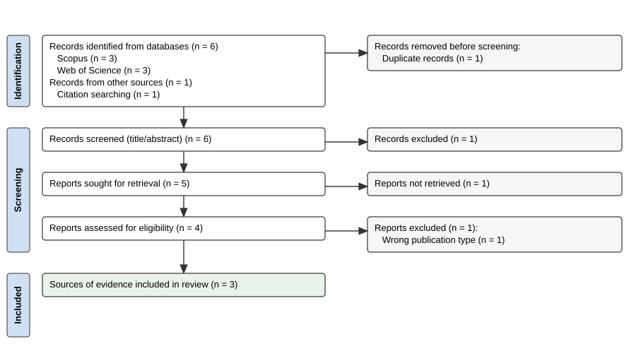

# Digital government services in Saudi Arabia: a scoping review

Author One, Author Two

> Draft generated by `prisma-scr`. Sections marked **[AUTHOR]** need to be written by the review team; numbers and methods text are generated from project data and should be re-generated after any change.

## Abstract

**Background:** [AUTHOR] Saudi Arabia has rapidly expanded digital public services under Vision 2030, but the research evidence is dispersed across disciplines. A scoping review can map what has been studied and where gaps remain.

**Objectives:** Map the volume and characteristics of research on Saudi digital government services; Identify the services, platforms and stakeholder groups studied; Summarise reported adoption factors, barriers and outcomes; Identify gaps in the evidence base.

**Eligibility criteria:** Sources addressing adoption, use, quality, and outcomes of digital / electronic government services (e-government, m-government, digital transformation) among citizens, residents, businesses and public-sector employees using or delivering government services in the context of Kingdom of Saudi Arabia, in particular initiatives under Vision 2030 (e.g. Absher, Tawakkalna, Nafath, Yesser), published 2005–2026.

**Sources of evidence:** Scopus, Web of Science, Citation searching; last searched 2026-11-23.

**Charting methods:** Data were charted using a standardised form (9 items) developed for this review.

**Results:** Of 6 unique records screened, 4 full-text reports were assessed and 3 sources of evidence were included. [AUTHOR: key findings]

**Conclusions:** [AUTHOR]

## Introduction

Saudi Arabia has rapidly expanded digital public services under Vision 2030, but the research evidence is dispersed across disciplines. A scoping review can map what has been studied and where gaps remain.

[AUTHOR: expand rationale, summarise existing reviews, and explain why a scoping review (rather than a systematic review) suits the question.]

### Objectives

Using the Population–Concept–Context framework, this review addresses:

- **Population:** Citizens, residents, businesses and public-sector employees using or delivering government services
- **Concept:** Adoption, use, quality, and outcomes of digital / electronic government services (e-government, m-government, digital transformation)
- **Context:** Kingdom of Saudi Arabia, in particular initiatives under Vision 2030 (e.g. Absher, Tawakkalna, Nafath, Yesser)

Objectives:

1. Map the volume and characteristics of research on Saudi digital government services
2. Identify the services, platforms and stakeholder groups studied
3. Summarise reported adoption factors, barriers and outcomes
4. Identify gaps in the evidence base

## Methods

This scoping review was conducted following the JBI methodology for scoping reviews and is reported according to the Preferred Reporting Items for Systematic Reviews and Meta-Analyses extension for Scoping Reviews (PRISMA-ScR) [Tricco et al., 2018].

### Protocol and registration

OSF: (add registration DOI or 'not registered')

### Eligibility criteria

Sources were eligible if published between 2005 and 2026 in en, ar, as journal-article, proceedings-article, report, dissertation.

Inclusion criteria:

- Empirical or conceptual study of a digital/electronic government service
- Conducted in, or reporting data specific to, Saudi Arabia

Exclusion criteria:

- Not about government / public services (e.g. purely commercial e-commerce)
- No Saudi-specific data or analysis
- Editorials, letters, or abstracts without full text

[AUTHOR: rationale for the criteria.]

### Information sources

| Source | Type | Date searched | Records |
|---|---|---|---|
| Scopus | database | 2026-11-01 | 3 |
| Web of Science | database | 2026-11-01 | 3 |
| Citation searching | other | 2026-11-23 | 1 |

The most recent search was executed on 2026-11-23.

Additional sources searched:

- Hand-searching reference lists of included studies
- Saudi Digital Government Authority (DGA) publications

The full search strategies are given in Appendix A.

### Selection of sources of evidence

Records were imported into the review program and duplicates were removed automatically using DOI matching and fuzzy title matching (similarity ≥ 0.93, publication year ±1), removing 1 duplicate record. Titles and abstracts were screened independently by 2 reviewers (R1, R2) against the eligibility criteria; records marked include or uncertain by both reviewers proceeded to full-text review, and disagreements were resolved by discussion. Inter-rater agreement was 83.3% (Cohen's κ = 0.57). Full texts were then assessed independently against the same criteria, with reasons for exclusion recorded. Inter-rater agreement was 100.0% (Cohen's κ = 1.00).

### Data charting process

A data-charting form was developed by the team (Appendix C codebook) and piloted on a sample of included sources. [AUTHOR: state whether charting was done independently, in duplicate, or by one reviewer with verification, and how authors were contacted.]

### Data items

| Item | Type | Allowed values |
|---|---|---|
| study_design | category | survey, interview, mixed-methods, case-study, experiment, review, conceptual, other |
| service_or_platform | text | free text |
| sector | category | health, interior, education, finance, municipal, justice, labour, multi-sector, other |
| stakeholder_group | category | citizens, residents, businesses, employees, mixed |
| sample_size | number | free text |
| theoretical_framework | text | free text |
| key_findings | text | free text |
| barriers | text | free text |
| facilitators | text | free text |

### Critical appraisal

Consistent with scoping review methodology, critical appraisal of individual sources was not performed.

### Synthesis of results

Charted data were summarised descriptively using frequency counts for categorical items and medians/ranges for numeric items. Text items were synthesised narratively. [AUTHOR: describe any thematic / content analysis.]

## Results

### Selection of sources of evidence

The searches identified 7 records (6 from databases, 1 from other sources). After removing 1 duplicates, 6 records were screened by title and abstract, of which 1 were excluded. Of 5 reports sought, 1 could not be retrieved; 4 full-text reports were assessed and 1 were excluded. A total of 3 sources of evidence were included (Figure 1).



Reasons for full-text exclusion:

- Wrong publication type: 1

### Characteristics of sources of evidence

Included sources were published between 2017 and 2022.

| Year | n (%) |
|---|---|
| 2017 | 1 (33%) |
| 2021 | 1 (33%) |
| 2022 | 1 (33%) |

| Publication type | n (%) |
|---|---|
| article | 1 (33%) |
| proceedings-article | 1 (33%) |
| journal-article | 1 (33%) |

### Synthesis of results

**study_design**

| study_design | n (%) |
|---|---|
| survey | 3 (100%) |

**service_or_platform**: reported in 0/3 sources. [AUTHOR: narrative synthesis]

**sector**

| sector | n (%) |
|---|---|
| interior | 3 (100%) |

**stakeholder_group**

| stakeholder_group | n (%) |
|---|---|
| citizens | 3 (100%) |

**sample_size**: reported in 3 sources; median 250 (range 250–250).

**theoretical_framework**: reported in 0/3 sources. [AUTHOR: narrative synthesis]

**key_findings**: reported in 0/3 sources. [AUTHOR: narrative synthesis]

**barriers**: reported in 0/3 sources. [AUTHOR: narrative synthesis]

**facilitators**: reported in 0/3 sources. [AUTHOR: narrative synthesis]

## Discussion

### Summary of evidence

[AUTHOR]

### Limitations

[AUTHOR] Consider: database coverage, language restrictions, grey literature, single-reviewer stages, and the absence of critical appraisal inherent to scoping reviews.

## Conclusions

[AUTHOR]

## Funding

(describe funding, or 'none')

[AUTHOR: funding of included sources, if charted.]

## References

Tricco AC, Lillie E, Zarin W, et al. PRISMA Extension for Scoping Reviews (PRISMA-ScR): Checklist and Explanation. Ann Intern Med. 2018;169(7):467-473.

Peters MDJ, Marnie C, Tricco AC, et al. Updated methodological guidance for the conduct of scoping reviews. JBI Evid Synth. 2020;18(10):2119-2126.

## Appendix A: Search strategies

**openalex** (limits: publication years 2005–2026; max 2000 records)

```
("e-government" OR "electronic government" OR "digital government" OR "m-government" OR "e-services") AND ("Saudi Arabia" OR Saudi OR KSA)
```

**crossref** (limits: publication years 2005–2026; max 1000 records)

```
e-government digital government services Saudi Arabia
```

## Appendix B: Included sources of evidence

| # | Source | study_design | sector | stakeholder_group | sample_size |
|---|---|---|---|---|---|
| 1 | Alzahrani L. et al. (2017). Analysing the critical factors influencing trust in e-government adoption from citizens' perspective: A systematic review and a conceptual framework. *International Business Review*. https://doi.org/10.1016/j.ibusrev.2016.06.004 | survey | interior | citizens | 250 |
| 2 | Basahel (2021). Absher platform usability evaluation. *Proc. Saudi Computer Society*. | survey | interior | citizens | 250 |
| 3 | Alanzi & Others (2022). Tawakkalna app acceptance during COVID-19 in Saudi Arabia. *Journal of Digital Government*. https://doi.org/10.5555/tawak.2022 | survey | interior | citizens | 250 |

## Appendix C: Data charting codebook

See `charting/charting_form_codebook.csv`.
